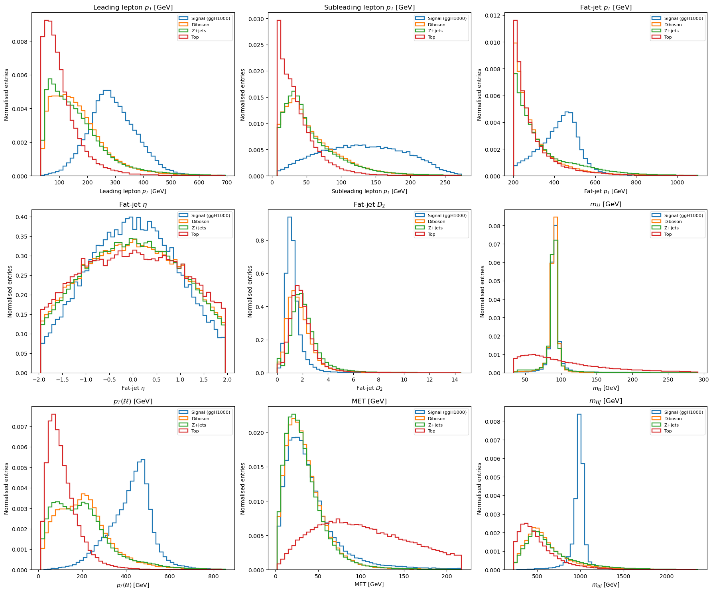
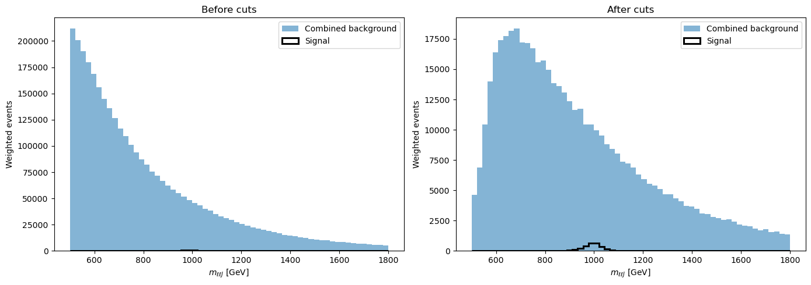
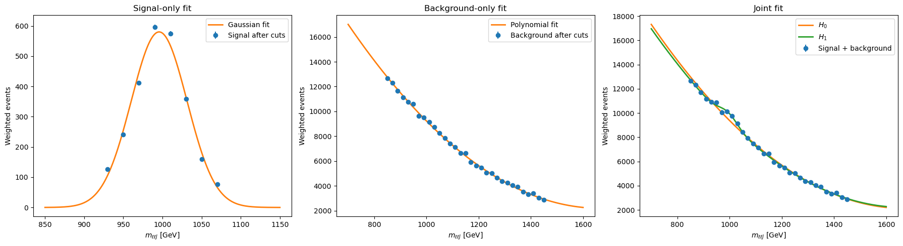
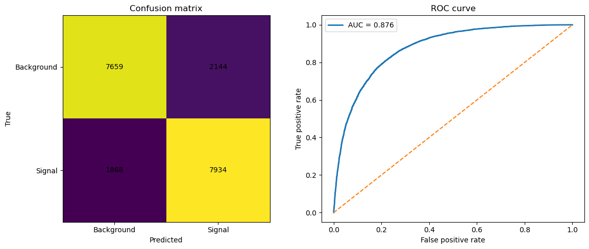
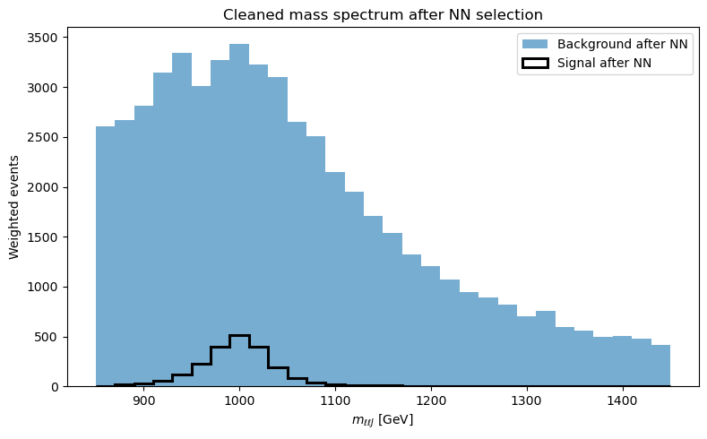
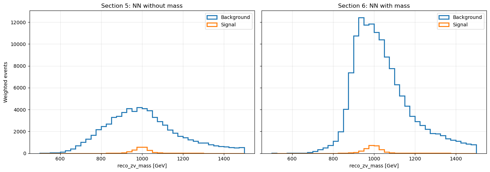

# Heavy-Resonance Search with Cut-Based Selection and Neural Networks

**Saqib Umair**  
MSc Particle and Nuclear Physics, University of Edinburgh

This project studies a weighted search for a heavy resonance near **1 TeV** in a dilepton-plus-fatjet mass spectrum. It compares conventional kinematic cuts with neural-network event selection and examines an important analysis question: **does a better classifier necessarily produce a better search?**

The answer in this study is no.

## Main result

The cut-based selection improves the simple sensitivity measure

**S/sqrt(B): 1.81 -> 4.06**

while retaining about **69%** of the weighted signal and reducing the background to about **9.5%** of its original weighted yield.

A neural network trained **without** the reconstructed mass variable improves the selection further:

**S/sqrt(B): 4.06 -> 8.08**  
**S/B: 0.0057 -> 0.0297**

A second network that **includes** the reconstructed mass achieves much stronger classifier metrics:

**ROC AUC: 0.983**

but produces a worse final search region than the mass-independent network:

**S/sqrt(B): 7.40**  
**S/B: 0.0192**

This is the main lesson of the project: **classification performance and physics sensitivity are not the same objective.**

## Analysis workflow

The weighted samples contain:

- signal: `ggH1000`;
- diboson background;
- Z+jets background;
- top background.

The analysis proceeds through:

1. kinematic-distribution studies;
2. cut-based event selection;
3. weighted mass-spectrum fits;
4. background-only (`H0`) versus signal-plus-background (`H1`) comparison;
5. MLP classifier without `reco_zv_mass`;
6. MLP classifier with `reco_zv_mass`;
7. comparison of classifier metrics and analysis-level sensitivity.



## Cut-based selection

The final square cuts reduce the weighted background from about **5.40 million** to **511,350**, while the signal changes from **4,200** to **2,901**.

| Quantity | Before cuts | After cuts |
|---|---:|---:|
| Weighted signal | 4,200.16 | 2,901.36 |
| Weighted background | 5,402,673.57 | 511,349.75 |
| S/B | 0.000777 | 0.005674 |
| S/sqrt(B) | 1.81 | 4.06 |



## Hypothesis test after cuts

The selected signal peak is approximated with a Gaussian near **996 GeV**. The background is described with a smooth polynomial model.

For the joint spectrum:

- `H0`: chi2/ndof = **80.664 / 28**
- `H1`: chi2/ndof = **28.726 / 27**
- Delta chi2 = **51.938**
- nominal Wilks significance = **7.11 sigma**



The quoted significance is a model-dependent result from this coursework study rather than an experimental ATLAS significance claim.

## Neural network without the mass variable

The first MLP uses eight kinematic inputs and deliberately excludes `reco_zv_mass`.

Test performance:

- accuracy: **0.795**
- ROC AUC: **0.876**



After applying the NN selection to the cut-selected sample:

| Selection | Weighted signal | Weighted background | S/B | S/sqrt(B) |
|---|---:|---:|---:|---:|
| Cuts only | 2,901.36 | 511,349.75 | 0.0057 | 4.06 |
| Cuts + NN without mass | 2,196.85 | 73,848.73 | **0.0297** | **8.08** |



The post-NN `H0/H1` fit gives a much larger formal significance, but the fit quality is poor. I therefore do **not** use the nominal 17.2-sigma value as the main result. The NN has changed the background shape enough that the simple fit model no longer describes it reliably.

## What changes when mass is included?

The second MLP includes `reco_zv_mass` directly.

Its classifier metrics improve substantially:

- accuracy: **0.945**
- ROC AUC: **0.983**

However, the final selected region is worse than for the mass-independent network:

| Model | ROC AUC | S/B | S/sqrt(B) |
|---|---:|---:|---:|
| NN without mass | 0.876 | **0.0297** | **8.08** |
| NN with mass | **0.983** | 0.0192 | 7.40 |



This illustrates why search-variable sculpting and analysis-level metrics matter. A classifier can become easier to optimise when it is given the resonance mass directly, but that does not guarantee a cleaner or more interpretable search region.

## Repository structure

```text
.
├── README.md
├── requirements.txt
├── notebooks/
│   └── heavy_resonance_search_ml.ipynb
├── figures/
├── results/
│   ├── selection_summary.csv
│   ├── nn_comparison.csv
│   └── hypothesis_test_summary.csv
└── data/
    └── README.md
```

## Data

The raw course-provided CSV files are not redistributed here. The notebook expects them under `data/raw/`.

## Tools

Python · pandas · NumPy · SciPy · scikit-learn · Matplotlib

## Scope

This repository presents a cleaned portfolio version of the analysis. It is a study using weighted HEP event samples and should not be read as an official ATLAS analysis or an experimental discovery claim.